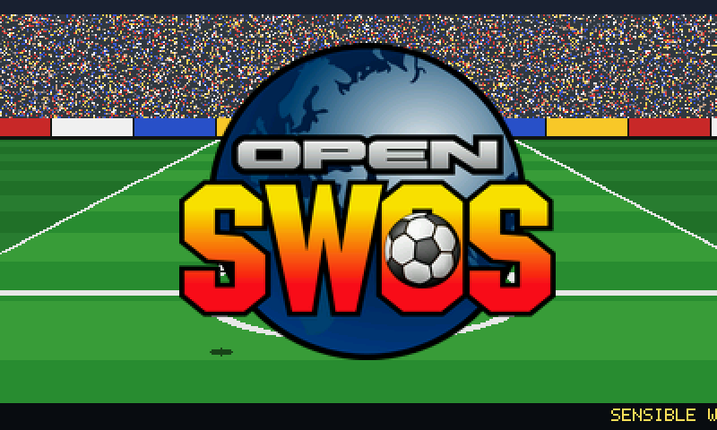
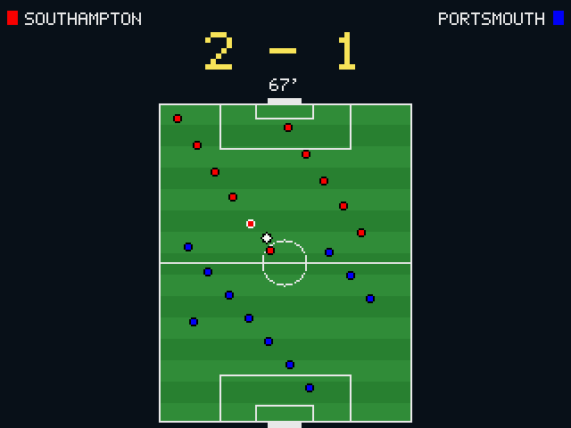

# OpenSWOS 3D for the Nintendo 3DS

***Sensible World of Soccer* on the Nintendo 3DS, in stereoscopic 3D.**

This is an **unofficial fork** of [OpenSWOS](https://github.com/benbaker76/OpenSWOS) by
Ben Baker and the OpenSWOS contributors. OpenSWOS rebuilds the Amiga game in C, and this
fork adds a Nintendo 3DS version of it. It is not made or endorsed by the OpenSWOS team or
by Sensible Software or its rights holders. For the PC, Mac, Linux and Amiga versions, go to
[OpenSWOS itself](https://github.com/benbaker76/OpenSWOS).

<p align="center"><b><a href="https://github.com/Znidz/OpenSWOS/releases">Download OpenSWOS 3D (.cia)</a></b></p>

<p align="center">


</p>

## Features

- **Matches in stereoscopic 3D.** The pitch tilts away from you, the players stand up off
  it, the ball rises out of the screen when it is in the air, and the score floats in front.
- **Menus on the touch screen.** Tap a button to choose it. The D-Pad and A still work.
- **A 3D title scene** on the top screen in the menus: a stadium and pitch going into the
  screen, with the OpenSWOS logo floating out of it and the credits scrolling along the bottom.
- **A match radar** on the touch screen, showing both teams, the score, the minute and the
  whole pitch. The players appear in their kit colours, the man you control has a white
  ring, and the ball gets bigger when it is in the air.
- **Seasons.** Play the classic 96/97 game or any other season you have, such as the
  community's 24/25 or 25/26 updates from [sensiblesoccer.de](https://www.sensiblesoccer.de).
  You switch between them with the SEASON button on the main menu.
- **Your own copy of the game, converted on the console.** The first start turns your Amiga
  disk images into the game's data. No PC step is needed, and nothing is downloaded.
- **Adjustable depth.** The 3D slider sets how strong the effect is, and a settings file
  sets each depth.
- It installs as its own app on the HOME menu.

## What you need

- A Nintendo 3DS, 2DS, New 3DS or New 2DS with **custom firmware** (to install `.cia` files
  with [FBI](https://github.com/Steveice10/FBI) or a similar installer). The 3D needs a
  3DS or New 3DS, because the 2DS models have no 3D screen. A New 3DS runs it faster.
- **Your own copy of *Sensible World of Soccer 96/97* for the Amiga**: the two disk images
  (`.adf`), a hard disk image (`.hdf`) or a WHDLoad `.lha`, unzipped or in a `.zip`.
  OpenSWOS 3D contains none of the game's data.
- For sound, the DSP firmware dump at `sdmc:/3ds/dspfirm.cdc` (made by
  [DSP1](https://github.com/zoogie/DSP1)), which every 3DS homebrew needs.

## Installing

1. **Get the app.** Open the [releases page](https://github.com/Znidz/OpenSWOS/releases) and
   use the newest **OpenSWOS 3D build**. On the 3DS, open FBI, choose **Remote Install → Scan
   QR Code**, and scan the QR code on the release page. Or download `OpenSWOS3D.cia`, copy it
   to the SD card and install it with FBI.
2. **Add your game.** Copy your SWOS 96/97 disk images to `sdmc:/3ds/OpenSWOS3D/`
   (create the folder if it is not there).
3. **Start OpenSWOS 3D** from the HOME menu. The first start makes the game's data from your
   disks, with progress shown on the touch screen, which takes about a minute. After that it
   starts straight away.

To update, install a newer `.cia` over the old one. Your data, saves and settings stay.

## Seasons

Give each season its own folder in `sdmc:/3ds/OpenSWOS3D/seasons/`:

```
sdmc:/3ds/OpenSWOS3D/seasons/9697/    the classic 96/97 disks
sdmc:/3ds/OpenSWOS3D/seasons/2425/    swos2425.hdf (sensiblesoccer.de's 24/25)
sdmc:/3ds/OpenSWOS3D/seasons/2526/    a 25/26 update
```

A folder can hold a **whole game** (two `.adf`s, an `.hdf` or a WHDLoad `.lha`) or **just a
season's team files** (`TEAM.000`, `TEAM.001` ..., loose, in a `.zip`, or on an `.adf` data
disk). Team files on their own are played with the graphics, sound and menus of your full
game.

Tap **SEASON** on the main menu's touch screen to choose. The list names each season, such as
"CLASSIC SWOS 96/97" or "SWOS 24/25", and a new season is named from its folder (`2526` reads
"SWOS 25/26"). Choosing one restarts the game and makes its data, which takes about a minute.
Holding **L** while the game starts opens the same list. Careers and saved competitions
belong to the season they were started in.

## Controls

| | |
|---|---|
| Circle Pad / D-Pad | move |
| A | fire |
| B | fire, skip |
| START | pause |
| SELECT | statistics |
| Y | instant replay |
| X | highlights after the match |
| L + R | quit the match |
| Touch screen | menus: tap a button |
| 3D slider | depth (off at the bottom) |

## Depth settings

`sdmc:/3ds/OpenSWOS3D/stereo.ini` is written the first time the game starts. It sets how
far each part of the picture sits in or out of the screen: the pitch, the players' height,
the score panel, and in the menus the backdrop, text, buttons and highlighted button. Edit it
on a PC, or delete it to go back to the defaults. The 3D slider then scales everything.

## Found a bug in the 3DS version?

Please report it on **[this fork's issues](https://github.com/Znidz/OpenSWOS/issues)**, not
to OpenSWOS, whose team does not support this version. Say which build you have, what you did
and what happened, and attach `sdmc:/3ds/OpenSWOS3D/SWOS.log`. A photo of the screens helps.

## How it is made

The 3DS version is OpenSWOS's own SDL build with a 3DS layer added. All the work is on the
[`stereo3d` branch](https://github.com/Znidz/OpenSWOS/tree/stereo3d), and GitHub builds the
`.cia` on every change ([`.github/workflows/build-3ds.yml`](.github/workflows/build-3ds.yml),
[`Makefile.3ds`](Makefile.3ds)). How the 3D, the two screens and the seasons work is described
in [docs/3DS.md](docs/3DS.md).

## Credits

- ***Sensible World of Soccer*** by **Sensible Software**: Chris Chapman, Jon Hare, Stoo
  Cambridge, Richard Joseph and the team (the full list is under
  [Credits](#credits-1) below). © Sensible Software and its current rights holders.
- **[OpenSWOS](https://github.com/benbaker76/OpenSWOS)** by **Ben Baker** (benbaker76) and
  the OpenSWOS contributors, with the DOS version reverse-engineered by **Zlatko Karakaš**.
  This fork would not exist without their work. If you enjoy it, please consider
  [supporting OpenSWOS](#support-development).
- **Season updates** by the [sensiblesoccer.de](https://www.sensiblesoccer.de) community.
- The 3DS fork is released under the same GPL v3 as OpenSWOS.

---

# About OpenSWOS

The rest of this page is OpenSWOS's own, about the desktop and Amiga versions this fork is built on.

***Sensible World of Soccer*, rebuilt in C from the original Amiga game.** Same game,
same feel, now on **Windows (10 or later), macOS, Linux, the Raspberry Pi** and the **Amiga 1200**,
with **online multiplayer**.

<p align="center"><b><a href="https://baker76.itch.io/openswos">Download OpenSWOS on itch.io</a></b></p>

## Getting started

**Official downloads: [baker76.itch.io/openswos](https://baker76.itch.io/openswos), linked
from [openswos.net](https://openswos.net).** Nowhere else is OpenSWOS's own.

1. **[Download it](https://baker76.itch.io/openswos)** for your computer.
2. **[Install it](INSTALL.md)**: a step-by-step guide with pictures.

OpenSWOS needs **your own copy of *Sensible World of Soccer 96/97*** (the PC version from
[GOG](https://www.gog.com/en/game/sensible_world_of_soccer_9697) is the easiest). The
game's graphics, music and teams aren't included: OpenSWOS Setup makes them from your
copy, once, and downloads nothing. [INSTALL.md](INSTALL.md) shows you how.

## Screenshots

| | |
|---|---|
|  |  |
| A match from the stand | Widescreen (16:9) |
|  |  |
| In play | Team line-up |
|  |  |
| Choosing teams | Picking a country |
|  |  |
| PC (DOS) graphics | Atari Jaguar sprites |
|  |  |
| The credits | The Amiga pitch |
|  |  |
| The Amiga 1200 (AGA) build in FS-UAE | The Amiga 1200 (AGA) build in FS-UAE |

## What's in it

- **The whole game:** friendlies, leagues, cups, the career mode with transfers and
  management.
- **Online multiplayer:** play a friend over the internet (MULTIPLAYER on the main menu).
- **Widescreen** at any resolution, fullscreen, CRT effects, gamepads, two players on one
  computer.
- **The PC and Amiga versions' looks and sounds**, and optionally the Atari Jaguar's
  sprites and SWOS 2020's pitches.
- **A real Amiga version** for the A1200/A4000 (AGA), built from the same source code.
- An **arcade (coin-op) mode** for cabinets.

## Documentation

| | |
|---|---|
| [INSTALL.md](INSTALL.md) | Installing and setting up, step by step |
| [docs/PLAYING.md](docs/PLAYING.md) | Keys, gamepads, two players, arcade mode |
| [docs/SETTINGS.md](docs/SETTINGS.md) | `SWOS.ini`, the command line, display and CRT options, where saves go |
| [docs/BUILDING.md](docs/BUILDING.md) | Building from source, for every platform |
| [docs/DEVELOPERS.md](docs/DEVELOPERS.md) | How the code is laid out, and where it came from |
| [docs/INDEX.md](docs/INDEX.md) | Every other document (netplay, replays, formats, the Amiga, ...) |

## License

Copyright (C) 2025-2026 Ben Baker and the OpenSWOS contributors.

OpenSWOS's own source code is free software: you can redistribute it and/or modify it
under the terms of the **GNU General Public License, version 3 or (at your option) any
later version** (GPL-3.0-or-later). See [LICENSE](LICENSE). In short: anyone who
distributes a build of OpenSWOS, changed or not, must make its complete source code
available under the same license.

It is distributed in the hope that it will be useful, but WITHOUT ANY WARRANTY; without
even the implied warranty of MERCHANTABILITY or FITNESS FOR A PARTICULAR PURPOSE.

The license does **not** cover:

- ***Sensible World of Soccer* itself.** The game and its graphics, sound, music, data
  files and code are © Sensible Software and their current rights holders, and nothing
  here grants any right to them. OpenSWOS is a fan project and is not affiliated with
  Sensible Software or its current rights holders.
- **Third-party code in `third_party/`**, which keeps its own license (see each folder):
  GGPO-X, ENet, miniz, SimpleMatchmaker and opl_models (MIT), Opal (public domain),
  dr_mp3 (public domain or MIT-0), and Tile Agent's runtime.

## Support development

If you enjoy OpenSWOS and want to support its development:

- Patreon: <https://patreon.com/Baker76>
- Ko-fi: <https://ko-fi.com/benbaker76>
- Buy Me a Coffee: <https://buymeacoffee.com/benbaker76>
- GitHub Sponsors: <https://github.com/sponsors/benbaker76>
- PayPal: <https://paypal.me/benbaker1976>

## Credits

```
Sensible World of Soccer

Developer                      Sensible Software
Publisher                      Renegade
Producer                       Graeme Boxall
Programmer / Coder             Chris Chapman
Graphics                       Jon Hare, Stoo Cambridge
Music & Sound                  Alex Joseph, Graham King, Jason Page,
                               Jon Hare, Richard Joseph

OpenSWOS

Port to C                      benbaker76
Reverse Engineering            benbaker76 (Amiga) / zkz (DOS)
AGA                            benbaker76
Multiplayer (GGPO-X)           thd79
Server Help                    Redhair
Test Lead                      Playaveli
Beta Testers                   Brummie, crom1, ElMichaJ, Elsheimy, EMPI,
                               gatifun, Mladen, Mózg, petarku, Predicador,
                               Rebel, Redhair, starwindz, thd79, umtytm,
                               Yashalkok
Donators                       benbaker76, Playaveli, starwindz, Petarku,
                               gatifun, burellapaolo, az0man0,
                               Cartoplotus68, JoSon, aliko
```

- **Ben Baker** ([github.com/benbaker76](https://github.com/benbaker76)) —
  reverse-engineered the SWOS Amiga 68k assembly in
  **[SWOS-RE](https://github.com/benbaker76/SWOS-RE)**, which this C port grew
  out of, and author of the port (originally two trees, `SWOS_C` for Amiga and
  `SWOS_C_SDL` for SDL, merged here into one).
- **Zlatko Karakaš** ([github.com/zlatkok](https://github.com/zlatkok/)) —
  reverse-engineered the original DOS version.
- **Richard Joseph** — RJP1 audio engine.
- **gabomdq** & contributors — SDL_GameControllerDB.
